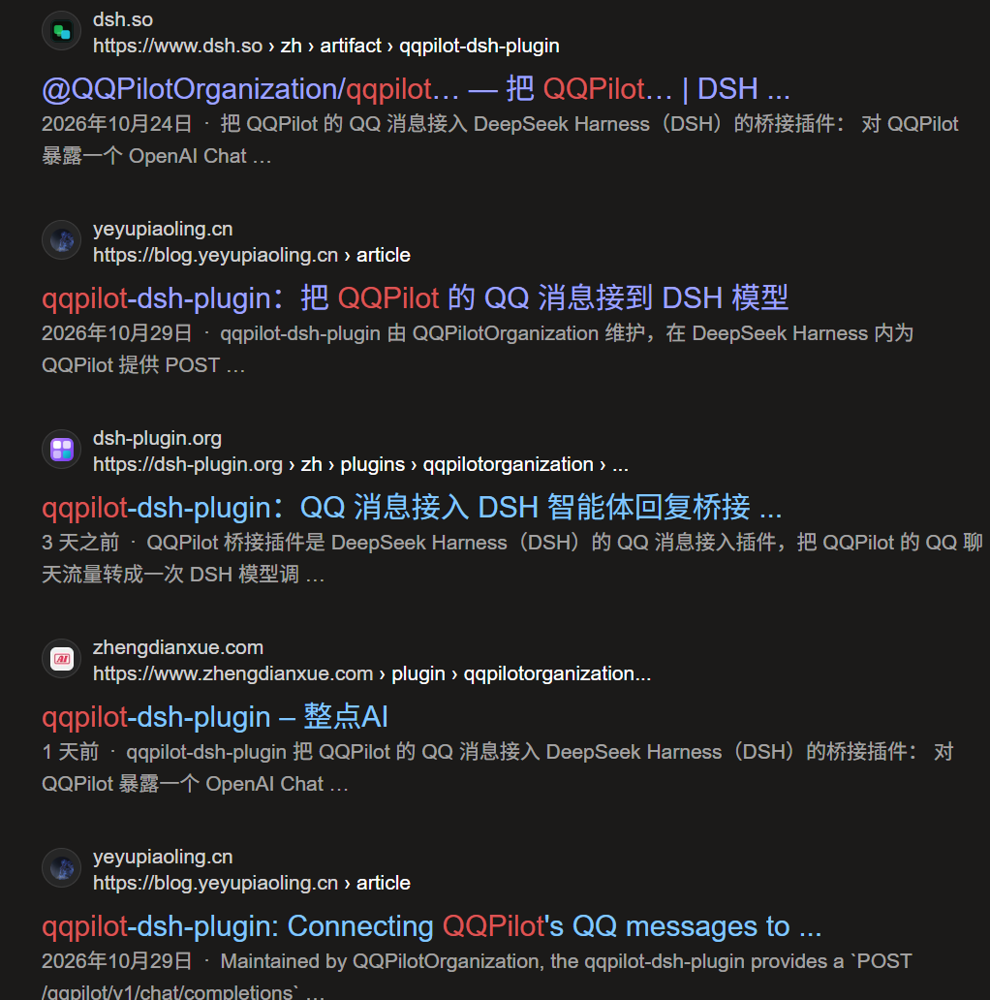

# qqpilot-dsh-plugin


<details>
<summary>突然有点害怕了</summary>



</details>


> 把 [QQPilot](https://github.com/QQPilotOrganization/QQPilot) 的 QQ 消息接入 DeepSeek Harness（DSH）的桥接插件：
> 对 QQPilot 暴露一个 **OpenAI Chat Completion 兼容端点**，由 DSH 里配置的模型通过**智能体工具**决定
> 「回复什么 / 不回复 / 附带图片」；提供 **工具 / 兼容 / 静默** 三种运行模式，并在设置页内置
> **可视化聊天动态**（实时看到收到的 QQ 消息、AI 的决定、回复内容、耗时与 token）。

QQPilot 原本只会把聊天记录 POST 给一个 OpenAI 兼容的 `/chat/completions` 并取回文本。
本插件接管这个端点后，把请求转成一次 DSH 模型调用，再把模型的决定收敛回 OpenAI 响应：
~~这是QQPilot官方认定的正确插件编写方式。~~


```
QQPilot ──POST /qqpilot/v1/chat/completions──▶ 本插件（DSH Host）
                                                   │
                                    ┌──────────────┴───────────────┐
                                    │ 工具模式（默认）              │ 兼容模式 / 静默模式
                                    │ 给模型 2 个工具：             │ 兼容：不给工具，直接返回文本
                                    │  qqpilot_reply(text, images)  │ 静默：不调用模型，只记录消息
                                    │  qqpilot_do_not_reply         │
                                    └──────────────┬───────────────┘
                                                   ▼
                                   DSH llm.stream（使用 DSH 当前默认模型）
                                                   │
             ◀── choices[0].message.content（字符串）+ 可选 message.images[] ──┘
```

## 功能

- **OpenAI 兼容端点**：`POST /qqpilot/v1/chat/completions`（非流式），另提供 `GET /qqpilot/v1/models`。
- **三种运行模式（设置页可切换）**
  - **工具模式（默认，agent）**：模型通过 `qqpilot_reply` / `qqpilot_do_not_reply` 决定是否回复、回什么。
  - **兼容模式（compat）**：不给工具，直接把模型输出作为回复返回，适合不支持 tool calling 的模型。
  - **静默模式（silent）**：不调用模型、不消耗 token，只把收到的消息记录到聊天动态里（观察/挂机用）。
- **智能体工具（工具模式）**
  - `qqpilot_reply`：模型决定回复时调用；参数 `text`（正文，**字符串或字符串数组**）与 `images`（图片路径 / http(s) URL / data URL）。
  - **一次回复多条消息**：`text` 传字符串数组时，数组每一项会作为一条独立的 QQ 消息，插件用 `[[NEXT]]` 拼接后返回给 QQPilot（QQPilot 会逐条发送）；字符串里的 `[[NEXT]]` 也会被展开成多条。
  - `qqpilot_do_not_reply`：模型决定保持沉默时调用，插件返回空 `content`，QQPilot 跳过发送。
  - 模型没有调用工具而是直接输出文本时，文本仍然会作为回复返回（不会因模型“忘记调工具”而丢消息）。
  - 多轮工具循环上限可配置；工具调用失败时可自动回退到兼容输出。
- **可视化聊天状态（两种入口，均已内置）**
  - **DSH 聊天窗口内**：聊天输入框上方常驻一条可折叠的「QQPilot」状态条，显示当前模式、最新一条 QQ 消息与 AI 决策；展开后可看最近 6 条收/发记录（含 DSH 工具调用），每 2 秒自动刷新。
  - **设置页 → 聊天动态**：完整记录视图，支持暂停刷新、查看耗时/token/工具调用与错误。
- **可调用 DSH 工具**：工具模式下可把 DSH 的工具（默认只读 + 联网：`read` / `glob` / `grep` / `read_image` / `web_search` / `web_fetch`）一并提供给桥接后的 AI；AI 可先查资料/读文件，再用 `qqpilot_reply` 回复。可在设置页选择「关闭 / 安全 / 全部」策略，危险工具（`pwsh` / `bash` / `write` / `edit` / `subagent` / `workflow` / `plugin_manager`）默认拒绝。
- **QQPilot Windows 辅助程序（DLC，默认关闭）**：可启用两个由工作空间内程序提供的工具 ——
  `qqpilot_get_chat_name`（调用 `get_chat_name.exe` 用 Windows OCR 读取当前群名）和
  `qqpilot_upload_files`（调用 `UploadFiles.exe` 上传并立即发送文件）。启用前需确认工作空间指向 QQPilot
  程序目录（含 exe/config.ini/file.png），设置页会先弹出确认提醒；两者都要求 AI 在最终回复/沉默前调用。
- **多用户上下文（QQPilot 的一次请求可能包含多个用户/多条消息）**：默认「完整上下文」会把请求里的所有用户消息交给模型，
  并在系统提示里列出本次参与用户与尚未回复的消息（可一次回复多条并 @ 对方）；聊天动态会显示「用户 N 位 / 输入 N 条」。
  可在设置里切到「旧版单条」只把最后一条用户消息交给模型。
- **模型选择**：默认跟随 DSH 全局默认模型；设置页「模型」卡片可改为仅 QQPilot 指定的 provider/model（下拉框，保存后下一轮生效），也可在 `cordis.patch.yml` 固定。
- **工具与工作区设置**：设置页可直接修改「工具轮数上限」（1-32）和桥接 AI 的「工作空间」目录；工作空间用于 DSH 工具（read/写文件等）、相对路径与本地图片路径。
- **返回图片**：回复图片会被规范化成 `data:image/...;base64,...` 放进
  `choices[0].message.images[].image_url.url`（QQPilot 唯一稳妥的图片返回形式）；仅有图片没有文本时会自动
  补一个短 caption，避免 QQPilot 把整条回复当作空内容跳过。
- **接收图片**：QQPilot 的 vision 请求（`content` 分段数组中的 `image_url`）会通过 DSH `attachments`
  服务转成模型可读的图片块；没有附件服务时退化为文字占位，不会让请求失败。
- **设置页**：DSH 设置 →「QQPilot 接入」，含「概览 / 聊天动态 / 设置」三个页签：端点地址、运行模式、
  附加指令、请求统计、测试连接与实时聊天状态。
- **运行时状态**：设置页的修改持久化在 `~/.dsh/qqpilot-dsh-plugin.json`（`mode`、`compatibilityMode`、
  `extraInstructions`），重启 DSH 后仍生效。

## 安装

本仓库就是一个 DSH bundle 包（`package.json` 里 `dsh.bundle.patch` 指向 `cordis.patch.yml`），无需构建步骤。

方式一：


方式二：在 DSH 当前 profile 里安装本目录（推荐，开发时本地链接）：

```text
plugin_manager → install_bundle → target = <本目录绝对路径>
```

或命令行：

```powershell
dsh plugin --profile <profile> add C:\path\to\qqpilot-dsh-plugin
dsh --profile <profile>
```

方式二：已安装后直接启用/停用 bundle（插件会热加载，无需改代码）：

```text
plugin_manager → set_bundle / set_plugin
```

安装成功后宿主日志会出现：

```
[qqpilot] QQPilot 接入已就绪 endpoint=http://127.0.0.1:<端口>/qqpilot/v1 模型=<provider>/<model> 兼容模式=false
```

## 配置 QQPilot

编辑 QQPilot 的 `config.ini`（`[general]` 段）：

```ini
# 指向本插件暴露的地址；末尾不要带 /，QQPilot 会直接拼 "/chat/completions"
server_url = http://127.0.0.1:55068/qqpilot/v1

# QQPilot 对 127.0.0.1 / localhost 不会发送 Authorization，这里留空即可
api_key =

# 本插件使用 DSH 当前默认模型；QQPilot 里的 modelname 不会被用于路由
modelname = deepseek-flash

# 需要把 QQ 里的图片也交给模型时开启（插件会把 image_url 转成 DSH 图片块）
isvisionmodel = true
remote_server_timeout = 300
```

> 端口以 DSH Web 实际监听为准（设置页里会显示完整端点）。如果 DSH 换了端口，QQPilot 的 `server_url` 也要同步改。
> QQPilot 的 Ollama / builtin 后端不会走本插件，请保持 `forceollamaapi = false`。

## 三种运行模式

| | 工具模式（默认，agent） | 兼容模式（compat） | 静默模式（silent） |
|---|---|---|---|
| 是否调用模型 | 是 | 是 | **否**（不消耗 token） |
| 模型收到的工具 | `qqpilot_reply` / `qqpilot_do_not_reply` | 无 | 无 |
| 决定回复 | 模型调用 `qqpilot_reply` | 模型直接输出文本 | 永不回复 |
| 决定沉默 | 模型调用 `qqpilot_do_not_reply`（返回空 content） | 模型输出空文本 | 总是返回空 content |
| 图片 | `qqpilot_reply.images` 支持本地路径 / URL / data URL | 不支持（只返回文本） | 不支持 |
| 聊天动态 | 记录完整决策 | 记录完整决策 | 只记录收到的消息（观察用） |
| 适合 | 支持 tool calling 的模型；希望“该不该插话”由模型自己判断 | 不支持工具的模型；或希望完全沿用 QQPilot system.txt 的直接输出 | 挂机观察 / 临时静音，不花钱 |

在 **DSH 设置 → QQPilot 接入 → 概览（或设置）** 里切换运行模式，立即生效并持久化；
也可以在该页「聊天动态」页签实时查看收到的消息与 AI 的回复/沉默/错误。

## 选择模型（三层，按优先级从高到低）

1. **插件设置页 →「模型」卡片（推荐）**：默认「跟随 DSH 默认模型」；关掉开关后可从下拉框选择
   provider 与 model（例如 `deepseek-official/deepseek-flash`、`llamacpp/MiniCPM5-1B-F16.gguf`、
   `xiaomi/mimo-v2.6-flash`），点「保存模型」后下一轮请求生效，持久化到 `~/.dsh/qqpilot-dsh-plugin.json`。
2. **DSH 全局默认模型**：未指定时插件实时读取 DSH 当前的默认模型，随 DSH 底部模型选择器 / Settings → Models 变化。
3. **`cordis.patch.yml` 的 `provider` / `model`**：给默认值用；设置页的显式指定会覆盖它。

> 模型列表通过 DSH `llm` 服务的 `listProviders()` / `listModels()` 实时读取；某个 provider 读取失败会在设置页提示。
> 不同模型能力差异较大：工具调用建议使用支持 tool calling 的模型（如 DeepSeek 系列）；本地小模型（1B 级）在
> 多工具场景下可能很慢甚至超时，可把 DSH 工具策略设为「关闭」或改用更大模型。
> 「一次多条消息」依赖模型愿意按数组输出；DeepSeek 系列实测可稳定遵循，小模型可能只回单条（仍可正常发送）。
> 若使用本地小模型（如 MiniCPM5-1B）并希望多条消息，建议切到**兼容模式**，在 `system.txt` / 附加指令里要求
> 用 `[[NEXT]]` 或换行分隔——QQPilot 会把它们逐条发送。

## 多用户 / 多消息上下文

QQPilot 不是标准的一问一答 Chat Completion 客户端：它每次把当前聊天窗口的记录整体发过来，所以一个请求的
`messages` 里可能包含**多个用户**（群聊）或同一用户的多条消息，格式为：

```
[time] <时间>
[username] <用户名>
[content] <内容>
```

本插件处理方式：

- **窗口语义**：QQPilot 抓取的是 QQ 聊天窗口本身，所以每个请求是**滑动窗口快照**——新消息追加到末尾，
  旧消息会随着窗口滚动被挤出；同一批历史消息可能出现在多次请求里。插件不保存跨请求的对话状态
  （避免不同群/私聊串线），每次都按当前窗口重建上下文。
- **待回复识别**：以窗口里最后一条 assistant 回复为界，其后的用户消息视为“尚未回复（pending）”，
  更早的用户消息只作为历史上下文；窗口整体滑动导致旧 assistant 消失时，这条规则仍然成立
  （被保留的用户消息后面一定有对应的 assistant 回复）。
- **完整上下文（`contextMode: all`，默认）**
  - 请求里的所有 user/assistant 消息都会传给模型（受 `historyLimit` 限制，默认 40 条）；
  - 系统提示会追加一段“本次请求是 QQ 聊天窗口快照（滑动窗口）…其中 M 条尚未回复”的说明，
    并只把 pending 消息单独列出；已经处理过的消息明确标为历史上下文，避免模型把旧消息误当新消息；
  - 聊天动态/状态条会显示本次请求的窗口用户数、窗口消息数与待回复条数；聊天动态里多条输入会逐条列出
    「用户名：内容」，并用「新 / 历史」标签区分。
- **旧版单条（`contextMode: latest`）**
  - 只把最后一条 user 消息 + system prompt 交给模型，忽略同一请求里更早的用户/历史消息；
  - 适合省 token 或想完全复刻旧版行为的场景。

在 **设置 → QQPilot 接入 → 设置 → 工具与工作区 → 上下文模式** 切换，或 `POST /qqpilot/api/config {"contextMode":"all"|"latest"}`。

## QQPilot 辅助程序（DLC，可选）

Windows 版 QQPilot 的 `data` 目录里带有两个「DLC」程序；本插件可以把它们包装成 AI 工具（**仅工具模式可用**，
默认关闭）：

| 工具 | 实际程序 | 作用 | 风险 |
|---|---|---|---|
| `qqpilot_get_chat_name` | `get_chat_name.exe` | 截图 + Windows OCR 读取当前 QQ 聊天窗口顶部群名/联系人名，帮 AI 确认在哪个会话 | 会截屏、需要 QQ 窗口在前台 |
| `qqpilot_upload_files` | `UploadFiles.exe` | 把工作空间内文件上传到当前 QQ 聊天 | **会立即发送文件**（可能早于文字回复），会模拟点击 QQ 窗口 |

启用要求：

1. **工作空间必须指向 QQPilot 程序目录**，例如
   `C:\Users\Develop\QQPilots\QQPilot\releaseBuild\1.5.20 x64 - Copy\data`，目录里要有
   `get_chat_name.exe` / `UploadFiles.exe` / `config.ini` / `file.png`；
2. QQ 已登录，并停留在目标聊天窗口（两个程序都依赖窗口坐标和截图）；
3. 在 **设置 → 工具与工作区 → 工作空间** 里设置上述目录；
4. 在 **设置 → QQPilot 辅助程序（DLC）** 里打开开关；启用前会二次确认，宿主也会再次校验程序是否存在，
   缺程序会拒绝启用并提示路径。

调用约定：

- AI 必须在 `qqpilot_reply` / `qqpilot_do_not_reply` **之前**调用这些辅助工具；调用结果会作为工具结果回给模型，
  模型再决定最终回复或沉默；
- `qqpilot_get_chat_name` 优先用 `zh-Hans-CN` OCR，语言包不可用时回退到系统默认语言；
- `qqpilot_upload_files` 只接受位于工作空间或 `imageRoots` 内的文件，单次最多 8 个；
- 两个工具都有超时（默认 90s），失败会把原因作为工具错误返回给模型，不会中断整轮。

## 工具轮数与工作空间

在 **DSH 设置 → QQPilot 接入 → 设置 →「工具与工作区」**：

- **工具轮数上限（1-32）**：模型一次回复里最多进行几轮工具调用。默认 4；调大可以让 AI 多查几轮资料，
  但更慢、更费 token。保存后下一轮请求生效。
- **工作空间路径**：桥接 AI 使用的目录（`workspaceRoot`）。
  - 留空 = 跟随 DSH 当前工作区；
  - 填绝对路径（相对路径按 DSH 进程目录解析），保存时会校验/自动创建目录；
  - 也可点「**选择目录…**」直接调起系统目录选择器（DSH Client `uiWorkspace.pickDirectory`），选完点「保存工作空间」生效；
  - 生效范围：`qqpilot-bridge` Agent 的工作目录（read/write/glob 等相对路径）、本地图片路径的允许根目录；
  - 保存后立即应用到已存在的 bridge Agent（`workingDirectory.set`），无需重启。

## 配置项

`cordis.patch.yml` 中 `config:` 支持以下字段（设置页暴露运行模式与附加指令）：

| 字段 | 默认 | 说明 |
|---|---|---|
| `mode` | `agent` | 运行模式：`agent`（工具）/ `compat`（兼容）/ `silent`（静默） |
| `compatibilityMode` | `false` | 旧版兼容字段；`true` 等价于 `mode: compat`（仍可用，会被 `mode` 覆盖） |
| `provider` / `model` | 空 | 空 = 跟随 DSH 默认模型；也可在这里给默认值（设置页「模型」卡片可覆盖） |
| `reasoningEffort` | 空 | 推理强度，空 = 跟随服务商默认 |
| `extraInstructions` | 空 | 追加到系统指令里的额外要求（三种模式都生效） |
| `maxToolRounds` | `4` | 工具循环最大轮数（1-32，设置页「工具与工作区」可改） |
| `workspaceRoot` | 空 | 桥接 AI 的工作空间目录；空 = 跟随 DSH 当前工作区；设置页可改，目录不存在会自动创建 |
| `contextMode` | `all` | `all` = 完整上下文（参考请求里所有用户/消息）；`latest` = 旧版单条（只把最后一条用户消息交给模型） |
| `enableGetChatName` | `false` | 启用 `qqpilot_get_chat_name`（OCR 群名，需工作空间含 `get_chat_name.exe`） |
| `enableUploadFiles` | `false` | 启用 `qqpilot_upload_files`（上传文件，需工作空间含 `UploadFiles.exe`） |
| `dshTools` | `safe` | 是否向桥接后的 AI 提供 DSH 工具：`off` / `safe`（只读+联网）/ `all`（除危险工具外全部） |
| `dshToolDeny` | `["pwsh","bash","write","edit","subagent","workflow","plugin_manager"]` | 始终拒绝的 DSH 工具名 |
| `maxDshToolCalls` | `6` | 单次请求内最多执行多少次 DSH 工具 |
| `historyLimit` | `40` | 最多转发的历史消息条数 |
| `requestTimeoutMs` | `180000` | 单次请求的模型调用超时（毫秒） |
| `fallbackToCompat` | `true` | 工具模式调用报错时是否回退为兼容输出 |
| `temperature` | `0` | `>0` 时发送；`0` 表示不发送该参数 |
| `maxTokens` | `0` | `>0` 时发送；`0` 表示使用服务商默认 |
| `maxInboundImages` | `8` | 单次请求最多读取几张入站图片 |
| `maxReplyImages` | `4` | 单次回复最多附带几张图片 |
| `maxReplyChars` | `500` | 回复长度上限（Unicode 字符），按 `[[NEXT]]` / 换行边界优雅截断；`0` = 不截断（QQPilot 自身仍会硬截断到 500） |
| `maxImageBytes` | `8388608` | 单张图片大小上限（8 MiB） |
| `imageRoots` | `[]` | 允许读取本地图片的根目录；默认允许 DSH 工作区 / cwd |
| `imageOnlyCaption` | `🖼️` | 只有图片没有文本时的占位 caption |
| `logRequests` | `false` | 是否打印每次请求的摘要到宿主日志 |

## HTTP 接口

| 方法 & 路径 | 用途 |
|---|---|
| `POST /qqpilot/v1/chat/completions` | QQPilot 使用的 OpenAI 兼容端点 |
| `GET /qqpilot/v1/models` | 模型目录（返回 DSH 当前模型） |
| `GET /qqpilot/api/config` | 设置页读取配置 / 端点 / 统计 / 运行时长 / 可用 DSH 工具列表 |
| `POST /qqpilot/api/config` | 设置页写入 `{mode?, compatibilityMode?, extraInstructions?, dshTools?, provider?, model?, maxToolRounds?, workspaceRoot?, contextMode?, enableGetChatName?, enableUploadFiles?}` |
| `GET /qqpilot/api/activity?since=&limit=` | 设置页「聊天动态」轮询：最近的消息 + AI 决策 |
| `POST /qqpilot/api/test` | 设置页“测试连接”：走一遍完整回复流程 |
| `GET /qqpilot/api/status` | 统计信息 |
| `GET /qqpilot/api/tools` | DSH 工具桥诊断：策略、可见工具、专用 bridge agent、全局/作用域工具 |
| `POST /qqpilot/api/tools/test` | 通过真实工具管线执行一次 `read`（读插件自身 package.json），验证 DSH 工具调用链路 |
| `GET /qqpilot/api/models` | 模型目录：DSH provider/model 列表、当前默认选择、生效模型 |
| `POST /qqpilot/api/client-error` | 浏览器端渲染/未捕获错误上报（写入宿主日志） |
| `GET /qqpilot/api/client-errors` | 最近 20 条浏览器端错误（排查设置页空白用） |

## 与 QQPilot 的输出约定

- `choices[0].message.content` 必须是**字符串**；空字符串表示这次不回复（QQPilot 会静默跳过）。
- **多条消息**：`qqpilot_reply.text` 可以是字符串数组，插件会按顺序用 `[[NEXT]]` 拼接；QQPilot 对 `[[NEXT]]`
  分段后每段单独按一次 `Ctrl+Enter` 发送，所以数组里每一项就是一条 QQ 消息（`gui_operation.rs` 的 `send_text`）。
- QQPilot 还会把回复里的 `\n` 逐行发送（段内换行也会变成多条消息），因此**单条消息内部不要用换行**；
  想发多条消息请用数组或 `[[NEXT]]`，不要依赖换行。
- 回复文本会被 QQPilot 硬截断到 500 字符（按 Unicode 字符计），图片会在文本之后上传。
- 图片放在非标准扩展字段 `choices[0].message.images[]`，值必须是 `data:image/<ext>;base64,...` data URL；
  文本为空时 QQPilot 不会上传图片，因此插件会在“只有图片”时补 caption。
- 更精确的协议依据（源码行号、字段硬性要求、失败时的静默行为）见 [PROTOCOL.md](docs/PROTOCOL.md)。

## 验证

```powershell
# 离线：用假 ctx / 假 llm 直接跑路由与工具循环（无需安装）
node test/host-unit.mjs

# 在线：模拟 QQPilot 发真实请求并严格校验响应形状
node test/mock-qqpilot.mjs --url http://127.0.0.1:55068/qqpilot/v1

# 在线：多场景验收（回复 / 文本路径 / 模式探测 / 图片）
node test/verify.mjs --url http://127.0.0.1:55068/qqpilot/v1
```

## 故障排查

| 现象 | 可能原因 |
|---|---|
| 设置页显示“加载失败” | 插件未加载 / 路由未注册；看宿主日志有无 `[qqpilot]` 报错 |
| **设置页空白 / 页签消失** | 插件热更新后旧组件实例与新版 hooks 不一致（或渲染异常）。**刷新 DSH 页面（F5 / Ctrl+R）**即可重新挂载；新版已加错误边界，异常时会显示提示而不空白。若仍异常，打开 `http://127.0.0.1:<端口>/qqpilot/api/client-errors` 查看上报的客户端错误 |
| QQPilot 端“机器人不理人” | `server_url` 写错（多了 `/`、端口不对）；模型调用报错被记为 500；看宿主日志 `[qqpilot] 请求处理失败` |
| 模型总是沉默 | 工具模式提示词让模型判断“不必插话”；可换成兼容性模式，或在 `extraInstructions` 里要求更积极回复 |
| 图片没发出去 | 图片路径不在 `imageRoots` / 工作区内；图片超过 `maxImageBytes`；模型只给了文本 |
| 模型调用报 401 / 无可用模型 | DSH 里没有可用的默认模型或凭据；先在 DSH 设置里选好模型 |

## 安全与兼容性

- 端点注册在 DSH 的 `webServer` 上，默认仅本机可访问；QQPilot 走回环地址，不需要 API key。
  如需从其它机器接入，请在网络层限制访问，并自行评估 `server_url` 使用非回环地址时 QQPilot 会发送
  `Authorization: Bearer <api_key>` 的行为。
- 目标环境：DSH `0.2.1` / `0.2.2` 系列（使用公开服务 `webServer` / `llm` / `attachments` / `agentDefaultModel` /
  `agents` / `tools` / `workingDirectory`；工具执行同时兼容 0.2.1 的单调用 API 与 0.2.2 的批量 executor API），
  Node.js `>=22.13.0`。无第三方运行时依赖。
- 插件卸载/热重载时自动注销所有路由与资源（`ctx.effect` 管理）。

## 验收结果（2026-10-24，DSH 0.2.1-rc.2 / 本机）

已通过 `plugin_manager install_bundle` 安装进 desktop profile 并热加载（`application: applied`）：

| 检查 | 结果 |
|---|---|
| `GET /qqpilot/api/config` | 200，endpoint=`http://127.0.0.1:55068/qqpilot/v1`，模型 `deepseek-official/deepseek-flash` |
| `POST /qqpilot/api/test`（工具模式） | `{"ok":true,"mode":"tool","reply":{"text":"连接正常，测试通过。"}}`，约 1s |
| 兼容性模式切换 + 持久化 | POST 开关生效；`~/.dsh/qqpilot-dsh-plugin.json` 写入 `{"compatibilityMode":true}`，切回 false 正常 |
| `test/mock-qqpilot.mjs` | PASS：HTTP 200，`content="等于2"`，响应形状符合 QQPilot 契约 |
| `test/verify.mjs` | PASS：硬场景 2/2；基础回复 / 文本路径 / 模式探测 / 图片返回全部通过 |
| 返回图片 | 模型调用 `qqpilot_reply(images=[data:image/png;...])` 后响应带 1 张 `message.images[]` data URL（**是否发图由模型决定**：另一次运行模型选择只发文字，属模型行为，不算协议失败） |
| 接收图片 | 入站 `image_url` data URL 经 `attachments` 转成图片块，模型正确回答了图片内容 |
| 静默 | 模型调用 `qqpilot_do_not_reply` 时返回空 `content`（统计 silences≥1） |
| 设置页 | Web Client `settings.section` 已出现 `qqpilot`（order 62，label「QQPilot 接入」），active=true |
| 离线单测 | `node test/host-unit.mjs` 全部 PASS（路由、系统消息合并、工具循环、图片、三种模式、聊天动态、旧配置升级、`[[NEXT]]` 清洗、400 校验） |

> 端口和模型取决于当前 DSH 会话，重启后以设置页显示的 endpoint 为准。

### 第二轮（可视化聊天状态 + 运行模式 + 深色模式修复）

| 检查 | 结果 |
|---|---|
| 运行模式切换 | `POST /qqpilot/api/config {mode}` 在 `silent` / `compat` / `agent` 间即时切换并持久化到 `~/.dsh/qqpilot-dsh-plugin.json` |
| 静默模式 | 请求 1ms 返回空 `content`，usage=0，不调用模型；聊天动态记录 `mode=silent, kind=silence` |
| 兼容模式 | 返回模型直出文本；聊天动态记录 `mode=compat, kind=reply` |
| 工具模式 | 模型经工具决定回复；聊天动态记录 `mode=agent, kind=reply`、耗时与 tokens |
| 聊天动态接口 | `GET /qqpilot/api/activity?since=0&limit=10` 返回 3 条（静默/兼容/工具），含 sender（从 `[username]` 解析）、入站文本、回复、图片数、elapsedMs、usage；增量 `since=latestId` 正常 |
| 设置页 | 设置页出现「概览 / 聊天动态 / 设置」页签与运行模式选择器；Web Client Slot 仍为 active（HMR 重载后） |
| 深色模式按钮 | 主按钮文字与开启态开关圆点改用 `--dsw-alias-label-primary-foreground`（浅色=白、深色=近黑），不再出现白字白底 |

> 可视化聊天状态为浏览器渲染；Slot 注册与接口数据已验证，实际视觉效果请在 DSH 设置页确认（必要时刷新页面加载最新客户端代码）。

### 第三轮（聊天窗口状态条 + DSH 工具调用）

| 检查 | 结果 |
|---|---|
| 聊天窗口状态条 | Web Client `conversation.input.dock` 中已注册 `qqpilot-status`（order 70，active）；输入框上方显示 QQPilot 模式与最新消息，展开看最近 6 条，2 秒自动刷新 |
| 设置页并存 | `settings.section` 的 `qqpilot` 仍 active（两个入口同时保留） |
| DSH 工具可见 | `GET /qqpilot/api/config` 的 `availableDshTools` 返回 `read, glob, grep, web_search, web_fetch, read_image`（安全策略） |
| DSH 工具作用域 | 插件自动创建专用 `qqpilot-bridge` Agent（挂载当前默认 preset），工具在该 Agent 作用域内执行，不污染用户会话；`GET /qqpilot/api/tools` 可看到 35 个可见工具与过滤结果 |
| DSH 工具真实调用 | `POST /qqpilot/api/tools/test` → `ok:true`，`read` 读取插件 package.json，9ms 返回内容（真实 `ctx.tools.execute` 管线） |
| 危险工具拒绝 | `pwsh / bash / write / edit / subagent / workflow / plugin_manager` 默认在 `dshToolDeny`，不会提供给模型 |
| 离线单测 | 新增“安全工具可见并可执行”“关闭策略不提供工具”“未知工具不执行”场景，全部 PASS |

> 工具调用发生在工具模式下；兼容模式与静默模式不会向模型提供任何工具。首次进入聊天窗口若看不到状态条，刷新一次页面即可加载新的客户端代码。

### 第四轮（模型选择）

| 检查 | 结果 |
|---|---|
| 模型目录接口 | `GET /qqpilot/api/models` 返回 7 个 provider（deepseek-official / deepseek-account / xiaomi / llamacpp / spark-x2 / qwen35 / deepseek-r1-0528-qwen3-8b）及各自模型 |
| 设置页模型卡片 | 设置 → QQPilot 接入 → 设置 → 模型：跟随 DSH 默认模型开关 + provider/model 下拉 + 保存模型 |
| 指定模型生效 | POST `{provider:"deepseek-official",model:"deepseek-flash"}` 后，`config.modelSource=override`，QQPilot 模拟请求 954ms 返回 `"等于2"` |
| 恢复默认 | POST `{provider:"",model:""}` 后 `modelSource=default`，当前默认 `llamacpp/MiniCPM5-1B-F16.gguf` |
| 持久化 | `provider` / `model` / `reasoningEffort` 写入 `~/.dsh/qqpilot-dsh-plugin.json` |
| 离线单测 | 新增模型目录 + 指定/恢复模型场景，全部 PASS |

### 第五轮（一次输出多条消息）

| 检查 | 结果 |
|---|---|
| 工具参数 | `qqpilot_reply.text` 支持 `string \| string[]`（JSON Schema `oneOf`） |
| 落库/返回 | 数组按顺序转成 `[[NEXT]]` 拼接的 `choices[0].message.content`；空字符串/空白项被丢弃；数组与 `[[NEXT]]` 混用会被展开 |
| 联机实测（默认模型） | 使用默认模型 `deepseek-account/deepseek-flash`，要求“一次回复三条独立消息”：返回 3 段 `[[NEXT]]`（打招呼 / 时间 / 卖萌），1.2s，活动记录 `messages=3` |
| 弱模型兼容 | 免费 `llamacpp/MiniCPM5-1B` 在工具模式下不能稳定调用工具（会把调用意图当普通文本输出）；但把运行模式切到**兼容模式**并提示“用 `[[NEXT]]` 分隔”，即可得到多段回复（实测 3 条：`[[NEXT]]` + 换行都会被 QQPilot 拆成独立消息） |
| 容错解析 | 如果弱模型把数组当字符串传（`'["a","b"]'` 或嵌套 `'[["a","b"]]'`），插件会尝试 JSON 解析并展开成多条消息 |
| 图片组合 | 数组文本 + images 同一回复时，文本多段 + 图片数组均正常返回（单测覆盖） |
| 兼容性 | 旧的单字符串写法、`[[NEXT]]` 写法、图片回复、工具调用全部回归通过 |
| 离线单测 | 数组、数组+`[[NEXT]]`、数组+图片 三个新场景 PASS |

### 第六轮（工具轮数 + 工作空间设置）

| 检查 | 结果 |
|---|---|
| 设置页 | 「设置 → 工具与工作区」新增：工具轮数上限（1-32）输入 + 保存、工作空间路径 + 保存、当前生效路径显示 |
| 工具轮数 | POST `{maxToolRounds:8}` → config 立即为 8 并持久化；`99` / `abc` 被拒绝并提示 1-32 |
| 工作空间 | POST 自定义目录 → 自动创建、`workspaceRoot`/`effectiveWorkspace` 更新；`workingDirectory.set` 应用到 `qqpilot-bridge` Agent（诊断 `appliedAgentWorkspace` 一致） |
| 非法路径 | 指向普通文件 → `ok:false`「工作空间路径不是目录」；清空 → 恢复跟随 DSH 工作区 |
| 工具调用回归 | DSH 0.2.2 的批量 executor API 适配后，`read` 自测 2ms 成功（兼容 0.2.1 单调用 API） |
| 持久化 | `maxToolRounds` / `workspaceRoot` 写入 `~/.dsh/qqpilot-dsh-plugin.json`，重启后保留 |
| 设置页修复 | 修复「工具与工作区」卡片引用未定义的 `roundsDraft` / `workspaceDraft` / `workspaceNotice`（应为 `props.*`），并加 ErrorBoundary：以后渲染异常显示提示而不是整页空白 |
| 目录选择器 | 工作空间路径旁新增「选择目录…」按钮，调用 DSH `uiWorkspace.pickDirectory()` 打开系统目录选择器，回填路径后保存 |

### 第七轮（多用户上下文 / 旧版单条开关）

| 检查 | 结果 |
|---|---|
| 识别多用户请求 | 用真实 `dest.json`（绿叶 / baiyan / 123 三位用户 + 2 条历史 assistant）验证，解析出 `userCount=3`、`participants=[绿叶,baiyan,123]`、`pendingCount=1` |
| 完整上下文（默认 all） | 模型收到全部 6 条消息；system 追加“本次请求包含 3 条用户消息…”与未回复消息列表；活动记录 `userCount=3/participants=3/pendingCount=1/contextMode=all`；实测回复 `收到，不乞讨！` |
| 旧版单条（latest） | 模型只收到 system + 最后一条（123）消息；活动记录 `userCount=1/participants=[123]/contextMode=latest`；实测回复正常 |
| 设置页 | 「工具与工作区 → 上下文模式」新增 完整上下文 / 旧版单条 两个选项，切换即持久化 |
| 聊天动态 | 多条用户输入时元信息显示「用户 N 位：… / 输入 N 条」 |
| 离线单测 | 新增 all/latest 两个多用户场景，全部 PASS |

### 第八轮（滑动窗口语义）

| 检查 | 结果 |
|---|---|
| 窗口识别 | 系统提示改为“QQ 聊天窗口快照（滑动窗口）”，只把最后一条 assistant 之后的用户消息列为待回复（pending），更早消息明确标为历史 |
| 待回复标记 | 活动记录新增 `pendingStart`/`incoming[].pending`；聊天动态逐条显示「新 / 历史」标签，元信息显示「窗口消息 N 条 / 待回复 M 条」 |
| 实测 dest.json | `userCount=3 / pendingCount=1`；`绿叶`、`baiyan` 标为“历史”，`123` 标为“新”；模型正常回复 |
| 全已回复窗口 | 窗口以 assistant 结尾时 pending=0，系统提示“窗口里的用户消息都已经有回复；除非仍有必要补充，否则保持沉默” |
| 设计取舍 | 不做跨请求状态缓存（QQPilot 无会话 ID，缓存会串群/私聊）；滑动窗口本身已提供必要的近期上下文，超出窗口的历史按设计丢弃 |
| 离线单测 | 新增 pending 标记、全已回复窗口断言，全部 PASS |

### 第九轮（QQPilot Windows DLC 工具）

| 检查 | 结果 |
|---|---|
| 启用校验 | 工作空间没有 `get_chat_name.exe` / `UploadFiles.exe` 时，POST 启用返回 `ok:false` 并提示 QQPilot data 目录示例 |
| 设置确认 | 设置页新增「QQPilot 辅助程序（DLC）」卡片：两个开关 + 程序是否存在提示 + 启用二次确认 + 风险说明 |
| 程序探测 | 工作空间切到 `releaseBuild\1.5.20 x64 - Copy\data` 后，`helperPrograms` 显示两个程序均 found，启用成功 |
| 工具注入 | 启用后工具模式模型可见 `qqpilot_get_chat_name` / `qqpilot_upload_files`；关闭/缺程序时不注入 |
| 调用顺序 | 辅助工具不结束回合，模型调用后继续循环，最后必须用 `qqpilot_reply`/`qqpilot_do_not_reply` 收尾；单轮辅助工具上限 4 次 |
| 参数校验 | UploadFiles 仅允许工作空间/imageRoots 内文件，最多 8 个；OCR 群名失败会返回明确错误文本 |
| 离线单测 | 启用拒绝、启用成功、两个工具执行、工具结果回喂模型、活动记录 helpers，全部 PASS |

> 若插件热更新时设置页一片空白：这是旧页面里 React 组件实例与新版 hooks 不匹配导致的，刷新页面即可恢复；
> 新版客户端已加 ErrorBoundary（异常会显示红色提示而不是空白）并把未捕获错误上报到 `/qqpilot/api/client-errors`。

## License

MIT
